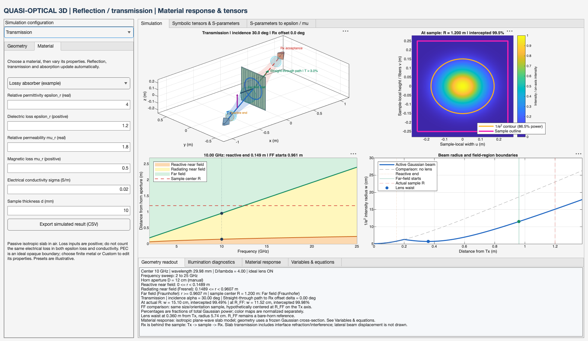
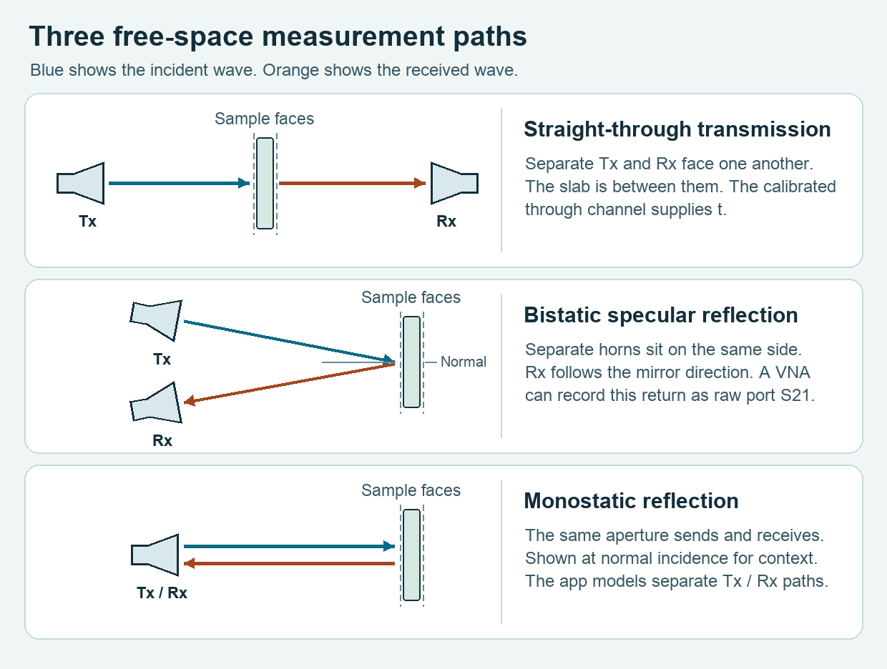
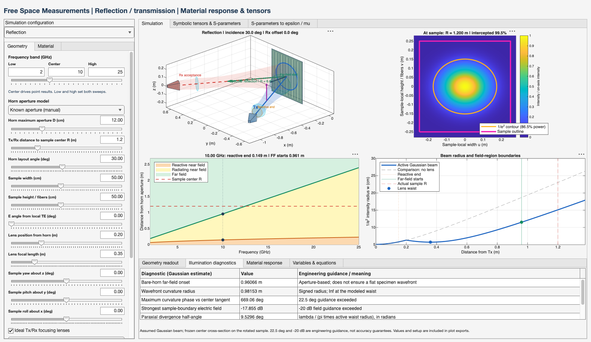
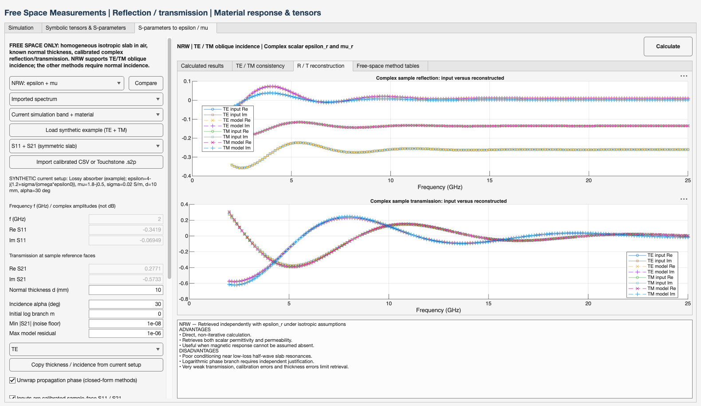
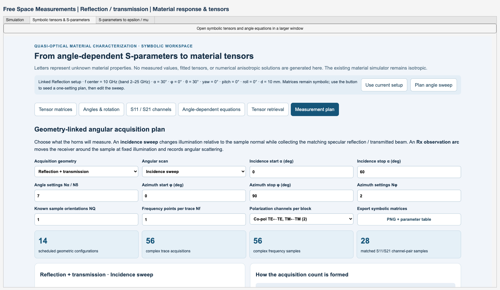

# Free Space Measurements

Plan microwave measurements of flat samples, compare horn and lens setups, and retrieve material properties from calibrated complex reflection and transmission data in MATLAB.

[**Open in MATLAB Online**](https://matlab.mathworks.com/open/github/v1?repo=tamayovegas/FREESPACEMEASUREMENTAPP&file=QuasiOpticalBistatic3D.m) · [**Download ZIP**](https://github.com/tamayovegas/FREESPACEMEASUREMENTAPP/archive/refs/heads/main.zip) · [**Website**](https://tamayovegas.github.io/FREESPACEMEASUREMENTAPP/)

## Quick start

1. Sign in using **Open in MATLAB Online**, or extract the ZIP and open its project folder in desktop MATLAB.
2. Run `QuasiOpticalBistatic3D`. Open **Simulation** to choose **Reflection** or **Transmission** and toggle the ideal lenses.
3. Open **S-parameters to epsilon / mu**. Select **NRW** and **Paper benchmark**, then choose **Load synthetic example (TE + TM)** and **Calculate**. This 6 GHz, 45° example uses a 10 mm slab with known values of $\epsilon_r=4-j0.08$ and $\mu_r=1$. Compare the recovered values and open **R / T reconstruction** to inspect the fit.

[](docs/assets/transmission-with-lenses.png)

*Simulated straight-through transmission at 10 GHz and 30° incidence. See [all four setup views](https://tamayovegas.github.io/FREESPACEMEASUREMENTAPP/#setups).*

## What it measures

A vector network analyzer (VNA) records how a microwave wave changes in amplitude and phase. Use the app to design the setup and simulate its response, then import sample-face data from the lab to estimate the properties of a homogeneous, isotropic slab in air.

| App area | Controls and what you can learn |
| --- | --- |
| **Frequency and geometry** | Set low, center, and high frequencies (defaults 2 / 10 / 25 GHz). Low and high set the simulation sweeps. Center sets the 3D geometry, beam footprint, and point results. Choose a known horn aperture or estimate one from nominal gain. Set horn distance and layout angle, sample width and height, yaw, pitch, roll, and the electric-field angle from local TE. Compare the actual incidence and receiver alignment after rotating the sample. |
| **Illumination** | Compare bare-horn field regions, ideal lens position and focal length, Gaussian beam waist and radius, footprint, intercepted power and spillover. Check the strongest edge field, wavefront phase variation, and receiver offset in **Illumination diagnostics**. |
| **Material simulation** | Start with air, an ideal conductor, finite-conductivity metal, a lossless dielectric, or an illustrative lossy absorber. Use **Custom material** to set thickness, real and loss terms of permittivity and permeability, and conductivity. Read reflected, transmitted, and absorbed power, phase, return and insertion loss, and the approximate specular plate radar cross section (RCS) in reflection mode. |
| **S-parameter retrieval** | Import calibrated complex CSV or Touchstone data, or enter one complex reflection/transmission pair. Use sample-face $S_{11}$ and $S_{21}$, or all four two-port coefficients for a reciprocal symmetric slab. Compare NRW, NIST iterative, and the new non-iterative method. Inspect phase branch, valid points, reconstructed complex channels, and TE/TM agreement for spectra with matching frequencies, incidence, and thickness. |
| **Tensor planning and exports** | Explore symbolic permittivity, permeability, and conductivity under isotropic or anisotropic assumptions. Plan incidence or receiver scans, sample rotations, and co- or cross-polarized acquisitions. Export simulation plots, parameter tables, CSV results, and the setup snapshot used for retrieval. |

## Measurement paths and calibration

In **straight-through transmission**, Tx and Rx are on opposite sides of the sample. In **fixed-angle bistatic reflection**, separate Tx and Rx horns are on the incident side and Rx follows the specular direction. That reflected wave can appear as raw VNA port $S_{21}$. Calibrate and map it to sample reflection $r$, which the app labels $S_{11}$. The calibrated through-path data supply sample transmission $t$, labeled $S_{21}$.

[](docs/assets/measurement-paths.png)

*Monostatic reflection uses a shared aperture and is shown as measurement context. The app models separate Tx and Rx paths.*

**TRL** uses an empty **thru** reference, a highly reflecting **reflect** standard, and a **line** with different electrical length. The thru establishes a reference with the specimen absent. A material measurement records the specimen’s response. Calibrate the fixture and de-embed any remaining path to the slab faces before import. Apply time gating in the lab when unwanted echoes can be separated in time. [TRL standards diagram](docs/assets/trl-standards.png) · [Calibration and channel mapping](https://tamayovegas.github.io/FREESPACEMEASUREMENTAPP/#calibration)

## How it works

### Frequency, distance, and lenses

For the bare horn, the field-region estimate uses the maximum aperture span $D$ and free-space wavelength $\lambda_0$:

```math
\lambda_0=\frac{c}{f},
\qquad R_{\mathrm{FF}}\approx\frac{2D^2}{\lambda_0}.
```

At **10 GHz**, $\lambda_0 \approx 30$ mm. For **$D=12$ cm**, the app estimates **$R_{\mathrm{FF}}\approx0.96$ m**. At a **1.2 m** horn-to-sample distance and **30° incidence**, ideal lenses at 0.20 m from the horns with 0.35 m focal length change the modeled beam radius at the sample from **23.0 cm to 15.1 cm**. The field-region threshold still describes the bare horn. Use the focused footprint, edge field, and local phase variation to judge how well the planned setup approximates plane-wave illumination.

[](docs/assets/illumination-diagnostics.png)

### Slab properties and retrieval

Permittivity describes the electric response. Permeability describes the magnetic response. Impedance mismatch causes interface reflections, and travel through the slab changes phase and amplitude. The app includes internal reflections and uses the $e^{+j\omega t}$ time convention. For relative permittivity $\epsilon_r=\epsilon'_r-j\epsilon''_r$, the dielectric loss tangent is $\tan\delta=\epsilon''_r/\epsilon'_r$. Effective electric loss can include conduction.

For identical air modes on both sides, the modeled fractions of incident slab power are:

```math
R=|r|^2,\qquad T=|t|^2,\qquad A=1-R-T.
```

**NRW** estimates scalar $\epsilon_r$ and $\mu_r$ at normal or fixed oblique incidence with TE or TM specified. **NIST iterative** and the **new non-iterative** method use normal incidence and assume $\mu_r=1$. Known thickness and a physically supported phase branch matter even when reconstruction agrees closely. Weak transmission or measurement errors can limit what is recoverable.

[](docs/assets/synthetic-nrw-reconstruction.png)

*The broadband example reconstructs complex reflection and transmission from synthetic isotropic-slab inputs. Experimental accuracy and MATLAB Online Basic compatibility remain unverified.*

### Isotropic and anisotropic materials

For an isotropic slab, the tensor reduces to $\boldsymbol{\epsilon}_r=\epsilon_r\mathbf{I}$. In the **symbolic planner**, an anisotropic tensor can have different directional components, with frame rotation $\mathbf{T}_{\mathrm{lab}}=\mathbf{Q}\mathbf{T}_{\mathrm{material}}\mathbf{Q}^{\mathsf T}$. The planner counts scheduled measurements. Numerical retrieval uses scalar isotropic models. TE/TM disagreement can also come from calibration, alignment, or finite-beam effects, and an off-specular receiver scan does not supply a matched slab reflection/transmission pair.

[](docs/assets/symbolic-tensor-planner.png)

[Measurement physics and derivations](https://tamayovegas.github.io/FREESPACEMEASUREMENTAPP/#science) · [Retrieval guide](https://tamayovegas.github.io/FREESPACEMEASUREMENTAPP/Retrieval_method.html) · [Reflection/transmission CSV template](SParameter_input_template.csv) · [Four-channel CSV template](SParameter_four_channel_template.csv) · [Technical guide](docs/TECHNICAL_GUIDE.md) · [Validation](V10_validation.md)

## References

- **Ghodgaonkar, Varadan, and Varadan (1989).** Focused horns, free-space TRL, and time gating. The experiment extracted dielectric properties from metal-backed reflection. The app retrieves properties from paired reflection and transmission of a slab in air. [Original IEEE paper](https://doi.org/10.1109/19.32194)
- **Baker-Jarvis et al. (2005).** Section 6.5 describes free-space setups within a broader treatment of material metrology, calibration, and uncertainty. [NIST Technical Note 1536](https://nvlpubs.nist.gov/nistpubs/Legacy/TN/nbstechnicalnote1536.pdf)
