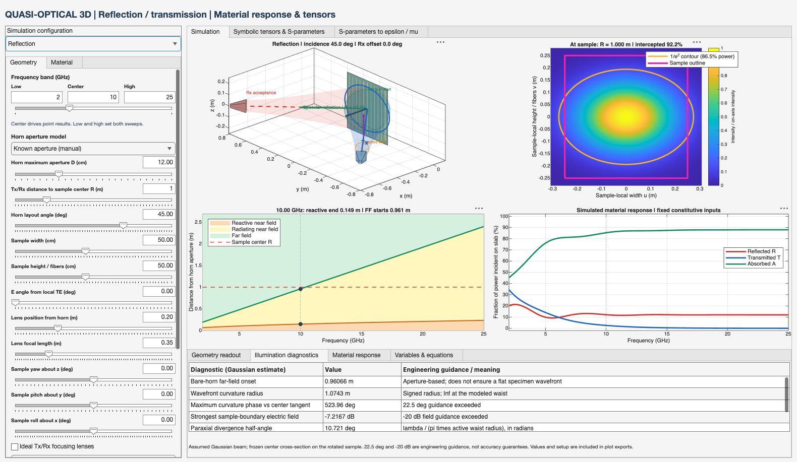

# Quasi-Optical 3D

MATLAB application for quasi-optical reflection and transmission simulation, scalar material retrieval, and symbolic tensor/acquisition planning.



## Get the app

Download the [latest release](../../releases/latest) or clone the source repository. In MATLAB, add the downloaded folder to the path and run:

```matlab
QuasiOpticalBistatic3D
```

The MATLAB Online launch link is configured in the repository README after its GitHub owner and repository are known. MATLAB Online requires a MathWorks account and an eligible license/product set; Basic access has monthly usage limits. The app is MATLAB code, not a public hosted service.

## Capabilities and limits

- Reflection/transmission simulation for homogeneous isotropic slabs, with TE/TM polarization and approximate Gaussian illumination diagnostics.
- Scalar S-parameter material retrieval and synthetic examples. Synthetic inputs are not experimental data.
- Symbolic tensor and acquisition-plan workspace. This is a specification/planning aid; it does not perform full tensor retrieval.

See the [retrieval guide](../Retrieval_method.html), [variables and equations](../Variables_and_equations.html), [symbolic workspace](../SymbolicTensors.html), and [v10 validation record](../V10_validation.md). Experimental accuracy has not been validated against reference measurements.

## Compatibility

Intended for MATLAB R2021a and later; tested in R2025b and v10 with R2026b. MATLAB Online Basic compatibility has not yet been verified. See the README for setup and the publication checklist for channel-specific access constraints.

## Distribution

Source and releases are provided through GitHub. The MATLAB File Exchange listing is linked to GitHub releases when published. GitHub Pages hosts these static project notes only; it does not host or run the MATLAB app.
